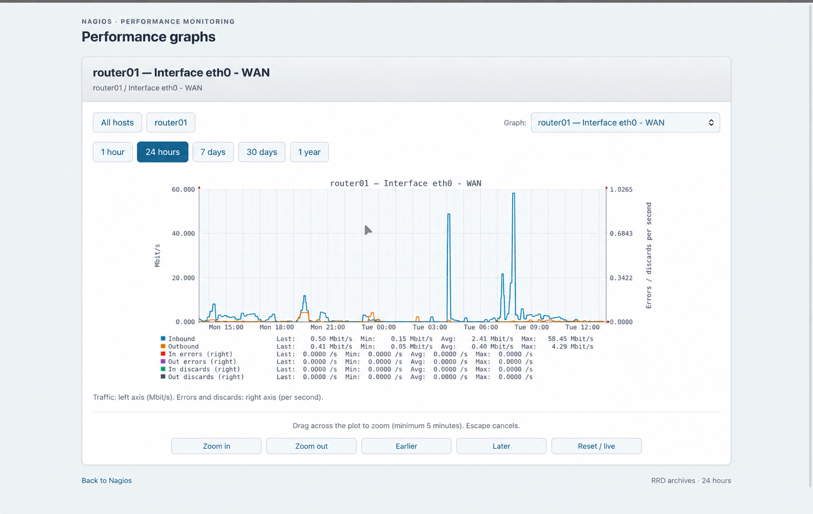
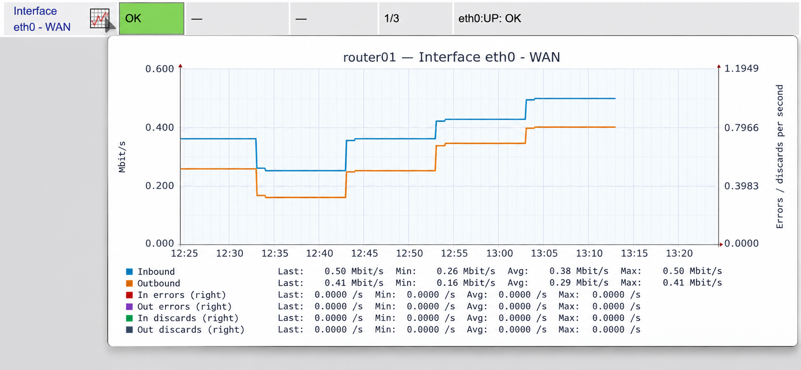

# nagios-graphs

Bounded Nagios Core performance-data collection, RRD archives and an authenticated,
read-only CGI viewer with hover previews and drag-to-zoom.

## Why this exists and what to expect

This started as an attempt to get useful graphs into the author's own internal
Nagios installation without the additional setup and maintenance of a separate
performance-data framework such as PNP4Nagios or nagiosgraph, or a Graphios/Graphite
pipeline. The aim is a small, understandable set of scripts using local RRD files
and a CGI viewer, with selected graphs declared explicitly in JSON.

It is a working personal project with limited testing outside that installation.
Installation is manual and can be rough around the edges. Expect to adapt paths,
permissions, perfdata labels and web integration to your environment. The examples
are a starting point; they are not a polished, universal installer. RRDTool and
web-server integration still need to be provided and maintained locally.

Runtime code is independent of host names and installation-specific graph rules.
An administrator-owned JSON catalog declares exact allowed metrics, archive identity,
graph lines, units, conversions, signed values, dual axes and gap overlays.
Missing or invalid configuration fails closed; there is no built-in host catalog.

## Setup

Requires Linux, Python 3.9+, RRDTool, systemd and an authenticated CGI-capable web
server. Node is needed only for interaction tests. The collector runs as Nagios;
the web server needs read-only archive/configuration access. Every viewer must be
allowed to see the entire catalog: Nagios contact authorization is not implemented.

- [Installation and Nagios integration](docs/install.md)
- [Configuration reference](docs/configuration.md)
- [Example catalog](examples/graphs.json)
- [Directory-based installation smoke test](docs/staged-test.md)
- [Release checklist](docs/release.md)

The interface generator reads enabled Nagios object files and expands explicit
interface checks into configured traffic/error/discard graphs. Optional private
archive seeds preserve history through service renames; exclusions are arguments.
It neither scans live devices nor modifies Nagios or archives.
See [interface plugins, command definitions and service examples](docs/configuration.md#plugins-and-nagios-commands)
for the required check setup.

```sh
python3 scripts/generate-interface-graphs.py --config-dir /etc/nagios4 \
  --catalog-base /etc/nagios4/graphs/base.json \
  --seed /etc/nagios4/graphs/interface-archives.json \
  --output /var/lib/nagios-graphs/catalog.json
```

The output is runtime state. Keep static configuration under `/etc`, executable
code under `/usr/local/libexec`, and generated catalogs/archives under `/var/lib`.
The site deployment owner controls locking, permissions, backups and activation.
Use `--stdout` for a preview or `--check --output ...` for drift checks.

## Visual examples

The following images are anonymized, image-edited illustrations based on the
internal installation. Identifying labels were replaced and surrounding details
removed; graph pixels and text may differ from the original screenshots. They
illustrate the interface, rather than serving as evidence of exact measurements.





## Tests

```sh
python3 -m unittest discover -s tests -v
node tests/test_nagios_rrd_drag.js
node tests/test_nagios_rrd_hover.js
```

Real-RRD tests skip without `rrdtool`. Manual GitHub Actions dispatch installs it
and runs the full suite. Ordinary PR CI retains minimal syntax/interaction checks.

## License and authorship

The code and documentation were cleaned up and prepared for public release by
Stijn Jonker with assistance from OpenAI ChatGPT/Codex. The project remains
maintained by the author; this assistance does not imply an independent audit
or broader compatibility testing.

Copyright Stijn Jonker and contributors. GPL-3.0-or-later; see [LICENSE](LICENSE).

